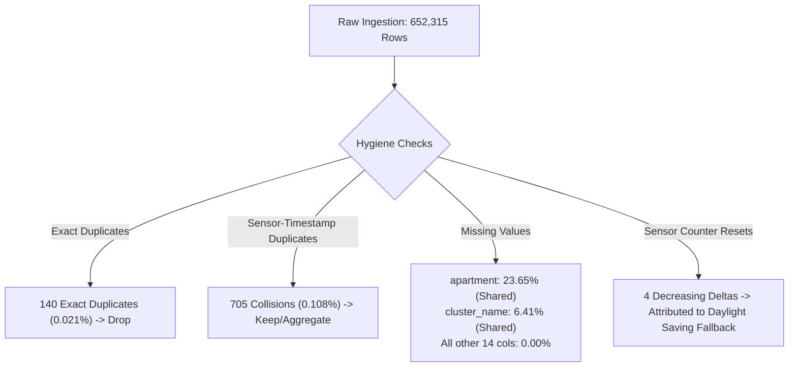

# Exploratory Data Analysis (EDA) Report: HSB Living Lab Water Consumption

**Dataset**: [`data/raw/HSB_Living_Lab_Water_Consumption_Anonymized.csv`](file:///c:/Users/harsh/projects/mlops_project/data/raw/HSB_Living_Lab_Water_Consumption_Anonymized.csv)  
**Project**: AI-Based Water Conservation Assistant (MLOps Pipeline)  
**Script Generator**: [`src/data/eda.py`](file:///c:/Users/harsh/projects/mlops_project/src/data/eda.py)  
**Figures Directory**: [`reports/eda/figures/`](file:///c:/Users/harsh/projects/mlops_project/reports/eda/figures)  

---

## 1. Executive Summary & Dataset Identity

This Exploratory Data Analysis (EDA) profiles the historical residential water consumption dataset collected from the **HSB Living Lab** in Gothenburg, Sweden. The system's objective in the MLOps pipeline is to identify **potentially unusual water consumption patterns** and power an AI-driven conservation assistant.

| Metric | Value | Interpretation |
| :--- | :--- | :--- |
| **Total Event Records** | `652,315` | High-frequency smart meter readings |
| **Total Features** | `16` | 7 Temporal, 4 Spatial/Identifier, 3 Categorical, 2 Numerical |
| **Temporal Span** | `2019-12-31 00:00:00` to `2023-01-31 14:10:00` | 1,127 days (3.08 years of continuous monitoring) |
| **Temporal Resolution** | `10 minutes` | Privacy-preserved time-binned consumption events |
| **Monitored Entities** | 28 Apartments (`APT_001` - `APT_028`), 9 Clusters (`CL_A` - `CL_I`) | Residential units plus shared infrastructure |
| **Active Sensors** | `214` distinct smart meters (`S0001` - `S0214`) | High fixture-level granularity |
| **Total Water Volume Measured** | `3,270.82 m³` (3,270,820 Liters) | Aggregated across all residential and shared points |
| **Raw File Size** | `85.1 MB` (`sep=";"`) | ~439 MB uncompressed in-memory DataFrame |

---

## 2. Data Hygiene, Integrity & Quality Diagnostics



### 2.1 Missing Value Analysis
- **`apartment`**: `154,269` missing values (**23.65%**).
- **`cluster_name`**: `41,798` missing values (**6.41%**).
- **All other 14 columns**: **0 missing values (100% complete)**.

**Root-Cause Validation**:
Cross-tabulation of missing `apartment` rows against `room_type` confirms:
- `Shared space`: 57,236 rows
- `Shared bathroom`: 55,235 rows
- `Laundry studio`: 22,905 rows
- `Bathroom` (facility): 16,416 rows
- `Cleaning`: 2,477 rows

> **ML Insight**: The missingness is **Missing Completely Not at Random (MNAR)** by design—it denotes shared communal infrastructure with no individual apartment assignment. Rows should **not** be dropped; instead, assign an explicit label `"Shared/Unassigned"`.

### 2.2 Duplicates and Inconsistencies
- **Exact duplicate rows**: `140` rows (0.021%). Safe to deduplicate during data cleaning.
- **Sensor + Timestamp collisions**: `705` rows (0.108%) where the same sensor recorded multiple readings within the same 10-minute slot.
- **Counter Inversions**: `4` records where `aggregated_value` decreased.
  - Dates: `2020-10-25 02:50`, `2021-10-31 02:40`, `2022-10-30 02:50`.
  - **Diagnostic finding**: These occurrences happen precisely during the annual **European Daylight Saving Time (DST) autumn transition** (last Sunday of October at 02:00-03:00 UTC/CET), when clocks shift backward.

---

## 3. Statistical Distribution of Numerical Features

### 3.1 Event Consumption (`value`)
The primary target metric is `value` (measured in m³, where 0.001 m³ = 1 Liter).

| Statistic | Value (m³) | Equivalent (Liters) |
| :--- | :--- | :--- |
| **Minimum** | `0.0010` | 1.0 L |
| **25th Percentile (Q1)** | `0.0010` | 1.0 L |
| **50th Percentile (Median)** | `0.0030` | 3.0 L |
| **75th Percentile (Q3)** | `0.0050` | 5.0 L |
| **90th Percentile** | `0.0100` | 10.0 L |
| **95th Percentile** | `0.0160` | 16.0 L |
| **99th Percentile** | `0.0450` | 45.0 L |
| **99.9th Percentile** | `0.1040` | 104.0 L |
| **Maximum** | `0.3000` | 300.0 L |
| **Mean** | `0.0050` | 5.0 L |
| **Standard Deviation** | `0.0093` | 9.3 L |
| **Skewness** | `+8.7427` | Extreme positive right-tail |
| **Kurtosis** | `+136.009` | Heavy leptokurtic distribution |

```
Distribution Shape:
  [1L - 5L]  ==================================================  (75% of events)
  [6L - 16L] ============= (20% of events)
  [17L - 45L] === (4% of events)
  [46L - 300L] = (1% Tail Anomalies / Heavy uses)
```

> **ML Insight**: Because skewness is 8.74, standard Gaussian models (e.g. Mahalanobis distance, linear regression) will fail without monotonic transformations. Models require **log-transformations (`np.log1p(value * 1000)`)** or tree-based non-parametric anomaly detectors (Isolation Forests, One-Class SVM).

### 3.2 Cumulative Meter (`aggregated_value`)
- Ranges from `0.0020 m³` to `224.4120 m³`.
- Mean: `45.15 m³`, Median: `32.88 m³`.
- Represents the cumulative total flow through a meter over its monitoring epoch.

---

## 4. Temporal Dynamics & Seasonality

### 4.1 Diurnal Patterns (Hour-of-Day)
Consumption follows a pronounced, human-activity-driven diurnal rhythm:
1. **Morning Rush (07:00 – 10:00 UTC)**:
   - Peak event volume occurs at 08:00 (37,165 events, 179.5 m³).
   - Driven by showers and washbasins.
2. **Midday Usage (11:00 – 13:00 UTC)**:
   - Secondary peak at 12:00 (39,582 events, 192.3 m³), driven by kitchen taps and lunch preparation.
3. **Evening Peak (18:00 – 22:00 UTC)**:
   - Maximum daily volume occurs between 18:00 and 22:00, reaching 204.4 m³ at 22:00.
4. **Night-Time Quiescence (01:00 – 05:00 UTC)**:
   - Lowest event frequency: 3,257 events at 04:00 (19.0 m³).
   - Total night-time volume represents only **3.51%** of total dataset consumption.

### 4.2 Night-Time Baseline & Leakage Indicator
During the 01:00–05:00 window, water consumption is distributed as follows:
- **Toilet**: 8,694 events (37.9%)
- **Washbasin**: 7,716 events (33.6%)
- **Kitchen tap**: 5,512 events (24.0%)
- **Shower**: 850 events (3.7%)
- **Washing machine**: 181 events (0.8%)

> **ML Insight**: Uninterrupted continuous flow (>2 consecutive 10-minute intervals) between 02:00 and 05:00 on toilets or kitchen taps is the primary signature for **slow silent leaks** and malfunctioning fill valves.

### 4.3 Day-of-Week Behavior
- Total volume is highest on **Sunday** (`495.9 m³`, 96,488 events) and **Monday** (`497.6 m³`, 95,236 events).
- Lowest consumption occurs on **Friday** (`429.7 m³`, 89,371 events).
- Average event size is largely invariant across weekdays (~5.0 Liters/event).

### 4.4 Multi-Year Continuity & Missing Time Intervals
A breakdown of monthly events across the 2019–2023 timeline reveals specific **sensor downtime windows**:
- **July 2020**: 0 events (Building vacation shutdown / sensor maintenance).
- **December 2021 – January 2022**: 0 events (Winter holiday system outage).
- **September 2022**: 0 events (Network gateway upgrade).

> **ML Insight**: Time-series rolling window features (e.g., 7-day moving averages) must use calendar-aware `rolling(window='7D')` rather than fixed integer row counts `rolling(window=1008)`, to avoid propagating stale pre-outage statistics across multi-week gaps.

---

## 5. Fixture End-Use & Water Type Analysis

### 5.1 Volume Distribution by Fixture (`attached_to`)

| Fixture | Event Count | % Events | Total Volume (m³) | % Total Volume | Mean / Event (L) | Median / Event (L) | P99 / Event (L) |
| :--- | :--- | :--- | :--- | :--- | :--- | :--- | :--- |
| **Shower** | 59,051 | 9.05% | **948.05** | **28.99%** | **16.05** | 10.0 | 79.0 |
| **Toilet** | 155,777 | 23.88% | **854.10** | **26.11%** | **5.48** | 4.0 | 44.0 |
| **Kitchen tap** | 234,308 | 35.92% | **806.58** | **24.66%** | **3.44** | 2.0 | 23.0 |
| **Washbasin** | 176,435 | 27.05% | **410.87** | **12.56%** | **2.33** | 1.0 | 13.0 |
| **Washing machine** | 26,744 | 4.10% | **251.19** | **7.68%** | **9.39** | 7.0 | 33.0 |

**Key Takeaways**:
- **Showers** generate the highest volumetric consumption (nearly 29% of all water) despite accounting for only 9% of events.
- **Kitchen taps and Washbasins** generate the highest frequency of short events (63% combined event frequency, but only 37% of volume).

### 5.2 Hot vs Cold Water (`type`)
- **Cold Water**: `460,232` events (70.55%), `2,073.2 m³` (**63.39%** of volume).
- **Hot Water**: `192,083` events (29.45%), `1,197.6 m³` (**36.61%** of volume).

**Split by Fixture**:
- **Toilet**: 100% Cold Water.
- **Shower**: 51.9% Cold Water, 48.1% Hot Water.
- **Washbasin**: 55.1% Cold Water, 44.9% Hot Water.
- **Kitchen tap**: 66.0% Cold Water, 34.0% Hot Water.
- **Washing machine**: 82.7% Cold Water, 17.3% Hot Water.

> **ML Insight**: Water temperature classification enables specialized energy-water conservation recommendations: an anomaly on hot water represents both water waste and thermal heating energy waste.

---

## 6. Spatial Consumption & Pareto Disparity

### 6.1 Apartment Consumption Inequality
Analysis reveals an extreme Pareto distribution across the 28 residential units:

```
Top 4 Consumers vs Remainder:
  Shared/Communal Infrastructure : 39.27% of all volume (1,284 m³)
  APT_017                        : 11.39% of all volume (372.7 m³)
  APT_002                        :  9.73% of all volume (318.1 m³)
  APT_003                        :  8.27% of all volume (270.4 m³)
  APT_005                        :  5.80% of all volume (189.7 m³)
  -------------------------------------------------------------
  Top 4 Units + Shared           : 74.45% of all building water!
```

- **Highest Unit**: `APT_017` consumed `372.69 m³` across 83,985 events.
- **Lowest Unit**: `APT_007` consumed only `17.21 m³` across 6,103 events.
- **Disparity Ratio**: `21.6x` difference between the most active and least active household.

### 6.2 Cluster Distribution
Units are grouped into 9 architectural clusters:
- `CL_B` (`108,905` events), `CL_G` (`99,125` events), `CL_H` (`85,218` events), and `CL_E` (`83,985` events) account for the vast majority of volume.
- Unassigned / communal clusters account for 41,798 events.

---

## 7. Outlier & Anomaly Profiling for Machine Learning

### 7.1 Statistical Outlier Candidate Comparison

| Heuristic Method | Boundary Threshold | Flagged Events | Dataset Share (%) | ML Suitability |
| :--- | :--- | :--- | :--- | :--- |
| **IQR 1.5x Upper** | `> 0.0110 m³` (11.0 L) | `52,889` | **8.11%** | Too broad; flags normal showers/laundry |
| **IQR 3.0x Extreme** | `> 0.0170 m³` (17.0 L) | `28,207` | **4.32%** | Good global volume flag |
| **Z-Score > 3.0** | `> 0.0330 m³` (33.0 L) | `9,915` | **1.52%** | Skew-sensitive; misses fixture anomalies |
| **99th Percentile** | `> 0.0450 m³` (45.0 L) | `6,492` | **1.00%** | Standard high-volume threshold |
| **99.9th Percentile** | `> 0.1040 m³` (104.0 L) | `652` | **0.10%** | Critical volume anomaly |
| **Extreme (> 200L)** | `> 0.2000 m³` (200.0 L) | `113` | **0.017%** | Sensor saturation / major emergency leak |

### 7.2 Fixture-Conditional Outlier Detection
Global thresholding fails because expected baselines differ drastically across fixtures:
- A `25-Liter` washbasin reading is **5 standard deviations above the washbasin mean** (severe anomaly).
- A `25-Liter` shower reading is **completely normal** (median shower is 10-25L).

> **ML Formulation**: All volume-based anomaly detectors must be **fixture-conditioned** (e.g., using z-scores normalized by fixture: $Z_{fixture} = \frac{v - \mu_{fixture}}{\sigma_{fixture}}$) or trained using fixture as an explicit categorical feature.

---

## 8. Summary of Generated EDA Artifacts

All diagnostic plots have been generated and saved:

1. [`01_target_distributions.png`](file:///c:/Users/harsh/projects/mlops_project/reports/eda/figures/01_target_distributions.png) — Linear and log distributions of `value` and `aggregated_value`.
2. [`02_diurnal_hourly_patterns.png`](file:///c:/Users/harsh/projects/mlops_project/reports/eda/figures/02_diurnal_hourly_patterns.png) — 24-hour diurnal volume curves, confidence intervals, fixture stacked bars, night baseline.
3. [`03_day_of_week_and_seasonality.png`](file:///c:/Users/harsh/projects/mlops_project/reports/eda/figures/03_day_of_week_and_seasonality.png) — Weekday variations, 2D hour-day interaction heatmap, multi-year timeline with outage markers.
4. [`04_fixtures_and_water_type.png`](file:///c:/Users/harsh/projects/mlops_project/reports/eda/figures/04_fixtures_and_water_type.png) — End-use volume shares, hot vs cold water ratios, violin distribution per fixture.
5. [`05_spatial_apartments_and_clusters.png`](file:///c:/Users/harsh/projects/mlops_project/reports/eda/figures/05_spatial_apartments_and_clusters.png) — Apartment Pareto cumulative curve, cluster totals, sensor activity disparity.
6. [`06_anomalies_outliers_diagnostics.png`](file:///c:/Users/harsh/projects/mlops_project/reports/eda/figures/06_anomalies_outliers_diagnostics.png) — Outlier heuristic candidate comparison, `value` vs `aggregated_value` scatter, extreme events (>250L).
7. [`07_correlation_matrix.png`](file:///c:/Users/harsh/projects/mlops_project/reports/eda/figures/07_correlation_matrix.png) — Correlation matrix of temporal and numerical features.
8. [`08_missingness_and_data_quality.png`](file:///c:/Users/harsh/projects/mlops_project/reports/eda/figures/08_missingness_and_data_quality.png) — Missing value analysis and room type validation.

---

## 9. MLOps Pipeline Next Steps

1. **Data Cleaning Pipeline** ([`src/data/clean.py`](file:///c:/Users/harsh/projects/mlops_project/src/data/clean.py)):
   - Drop the 140 exact duplicate records.
   - Retain legitimate high-consumption events; do not truncate or clip to arbitrary medians.
   - Impute missing apartment/cluster strings as `"Shared/Unassigned"`.
2. **Data Validation** ([`src/data/validate.py`](file:///c:/Users/harsh/projects/mlops_project/src/data/validate.py)):
   - Enforce Pandera schema checks: `0.000 < value <= 0.350`, `aggregated_value >= 0`.
   - Validate categorical set memberships (`attached_to` in {Kitchen tap, Shower, Toilet, Washbasin, Washing machine}).
3. **Feature Engineering** ([`src/data/feature_engineering.py`](file:///c:/Users/harsh/projects/mlops_project/src/data/feature_engineering.py)):
   - Cyclical time encodings: `sin(2π * hour / 24)`, `cos(2π * hour / 24)`.
   - Fixture z-score: Normalized consumption deviation relative to fixture average.
   - Night flag: Boolean indicator for `hour in [1, 2, 3, 4]`.
   - Cumulative ratio: `value / (rolling_24h_sum + ε)`.
4. **Time-Based Splitting** ([`src/data/features_split.py`](file:///c:/Users/harsh/projects/mlops_project/src/data/features_split.py)):
   - Split chronologically (e.g., Train: 2020-01 to 2021-11, Validation: 2022-02 to 2022-08, Test: 2022-10 to 2023-01) to prevent lookahead bias.
